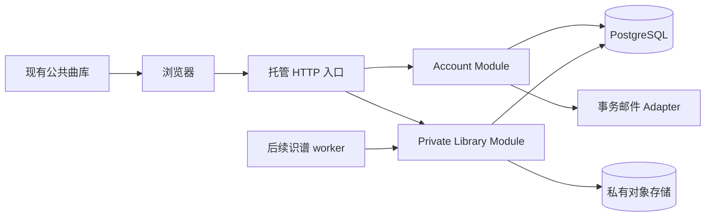
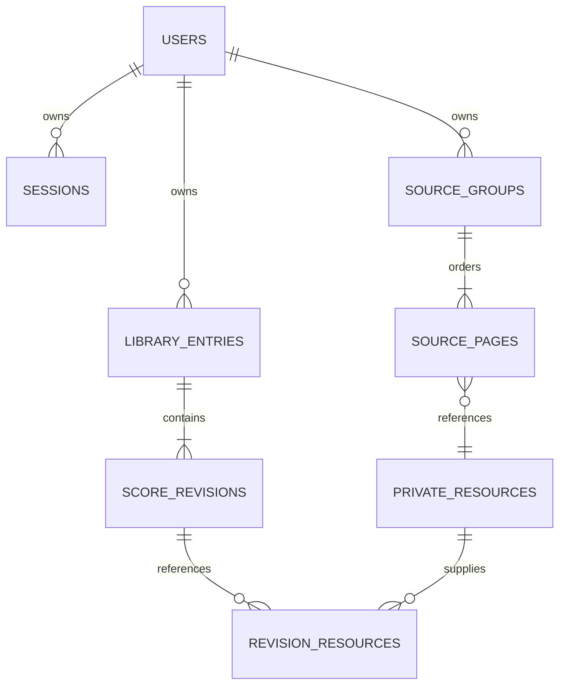

# 账号与私有曲库设计

日期：2026-10-21。状态：设计完成，待实现。适用版本：邀请制教师收费版。

首版以个人账号拥有曲库：老师和成人学习者都能私有保存原始曲谱、数字谱与修改历史，并在另一台设备登录后继续使用。老师身份是产品用途，不会自动获得其他用户的访问权。现有本机版继续独立运行，现有公共曲库继续提供公开内容。

本设计确定数据归属、登录、存储、Interface、迁移、图片素材接入与验收条件。教师分享、支付、识谱调度和自动评弹分别在后续任务实现；本设计为它们保留关联位置，不把未实现能力写成可用功能。

## 1 已有能力与需要调整的位置

| 位置 | 当前行为 | 设计中的处理 |
| --- | --- | --- |
| `src/library.js` | 统一曲库操作，选择磁盘或浏览器 Adapter | 继续作为曲库入口，增加 hosted Adapter；显式区分本机和账号曲库 |
| `lib/library-format.ts` | 乐谱与资源校验，修订、备份格式 | 复用音乐数据校验；账号归属与服务端审核凭据放在外围，不塞进乐谱文档 |
| `lib/library-store.mjs` | 本机磁盘持久化，旧数据迁移、删除标记 | 保留；不直接作为多用户数据库 |
| `src/library-indexeddb.js` | 当前浏览器的曲库、原图与 metadata | 保留游客数据；托管版首版只在内存缓存私有数据 |
| `src/task-vault.js` | 本机识谱任务恢复 token | 留在本机；托管任务用账号授权，不导入这些 token |
| `server.mjs` | 回环地址检查，本机会话与 CSRF | 保持本机保护；新增独立托管入口，不直接删除本机限制后上线 |
| `lib/auth.mjs` | 模型服务商登录与凭据 | 不承担产品用户登录；另建 account 模块 |
| `src/capabilities.js`、`src/api-client.js` | local / browser 模式，本机请求限制 | 增加 hosted 模式和账号请求；禁止托管模式访问本机设置、GitHub 管理入口 |
| `public/cloud-library/`、`score-repo/` | 随 Git 发布的公共曲目 | 客户上传、私有原图与账号信息不进入这些目录 |

当前 `LibraryRecord` 含 `originalFile` 和带二进制的 `assets`。托管传输将二进制拆成受权资源引用，由 Adapter 按需恢复现有编辑器需要的形状；避免列表读取整首谱、全部原图与全部历史。当前 `librarySummary` 含 document / score，也不能直接当托管列表返回值。

## 2 首版产品规则

1. 采用邀请制邮箱验证码登录。现有用户可再次登录，新用户须有绑定该邮箱的有效邀请；不要求用户配置模型账号。
2. 每个账号有一个私有曲库；首版不建立琴室组织、团队成员或班级权限。
3. 登录成功只展示服务器上属于该账号的曲目。本机曲库和游客浏览器曲库仍留在原处，上传需要用户主动选择。
4. 新增、修改、识谱结果都默认私有。保存和公开发布是两种操作；本阶段不新增私有内容的公开发布功能。
5. 账号曲库显示“已保存到账号”必须有服务端确认；仅在编辑器中的改动显示“未保存”。首版离线时允许导出草稿，恢复连接后由用户保存，不自动排队重放写请求。
6. 老师和学生之间的分享后续使用独立授权，固定到指定修订。持有练习链接不会成为曲谱所有者。

### 页面和状态

| 页面或状态 | 用户可见内容与操作 |
| --- | --- |
| 未登录 | 使用公开示例、本设备曲库；点击账号曲库进入登录 |
| 登录 | 邮箱、验证码、发送倒计时；不在界面暴露邮箱是否已注册 |
| 已登录 | 账号邮箱、账号曲库、设备会话、退出；教师 / 自学用途可选，不影响权限 |
| 账号曲库 | 曲名、乐器、来源类型、最近保存时间、修订、审核状态；原文件和图片按需读取 |
| 导入本设备数据 | 选择曲目，预览原图、历史和体积，突出目标邮箱，处理重复和冲突 |
| 保存冲突 | 保留编辑中的内容，允许载入服务器新版本或另存副本，不自动覆盖 |
| 会话失效 | 停止私有请求，提示重新登录；不把原账号的未保存内容自动提交给新账号 |

## 3 部署与 Module 设计

托管版采用同源前端与 Node 后端、PostgreSQL 保存身份和曲库元数据、私有对象存储保存原文件和图片。首版一个应用实例即可，采用单区域部署；不引入微服务。数据库与对象存储的供应商在部署时选择，Interface 不依赖供应商品牌。

| Module | 对外 Interface | 集中承担的 Implementation |
| --- | --- | --- |
| Account | `requestCode`、`verifyCode`、`requireSession`、`revokeSession` | 邀请、验证码、身份解析、限流、会话、CSRF、近期验证 |
| Private Library | `list`、`read`、`save`、`remove`、`restore`、`export`、`import` | 所有权、资源归属、修订冲突、完整提交、回收站、备份与导入回执 |
| Source Intake | `stage`、`receive`、`complete`、`group` | 类型与大小验证、哈希、原图方向、页序、未完成上传清理 |

Private Library 的调用方只提交业务输入，不自行计算 owner、对象存储路径或下一个 revision。身份由 Account 提供；数据库、对象存储、邮件、时钟与随机数通过内部 seam 注入。现有磁盘和 IndexedDB 是继续使用的真实 Adapter；新增 hosted Adapter，不为假想数据库扩展过多 Interface。

本机请求继续走现有 `/api/`。托管请求固定走同源 `/api/v1/`，不接受任意客户端指定的后端 URL，不开放跨域凭据请求。GitHub Pages 仍属于 browser 模式，不宣称具有托管账号能力。

## 4 登录与会话

### 邮箱验证码

- 邮箱规范化采用同一规则：去首尾空白、规范化域名并统一大小写作为产品身份键；不删除 `+tag`，不合并点号别名。首版支持常规 ASCII 邮箱，原始输入仅用于显示和投递。
- 验证码为随机 8 位数字，有效期 10 分钟，最多尝试 5 次；重发间隔 60 秒，单邮箱每 15 分钟最多 3 次。IP 与全站另设发送和验证上限，限流数据由数据库共享，不依赖进程内 Map。
- 每个 challenge 绑定邮箱、用途和登录前浏览器 nonce。数据库保存带服务端密钥的 HMAC，不保存明文验证码；密钥与数据库分开配置。比较使用恒定时间函数。
- 请求验证码对未知邮箱、未受邀邮箱和有效邮箱统一返回 `202` 与相同形状的 challenge。未知邮箱的验证不能创建账号。有效邮箱由服务器投递邮件，不把验证码回传给浏览器或写日志。
- 发送失败将 challenge 标记无效；外部投递超时不盲目重试旧验证码，用户等待倒计时后重新申请。日志仅记脱敏投递状态。验证码消费、邀请消费和账号创建在同一数据库事务中完成，禁止双重兑换。
- 未登录时先请求 `/api/v1/auth/context`，服务器设置 10 分钟有效的 `__Host-qinban_login` 随机 HttpOnly Cookie 并返回绑定它的 CSRF token。发送和验证要求同源 JSON 请求、Origin 校验及该 nonce；近期验证则绑定现有登录会话且邮箱必须与本人一致。邀请码和验证码均不可用于重放登录。首版不提供修改邮箱；后续须同时验证新旧邮箱并撤销旧会话。

### 登录状态

登录成功生成 32 字节随机不透明会话 token，只通过 `__Host-qinban_session` Cookie 传输，设置 `Secure; HttpOnly; SameSite=Lax; Path=/`，不设置 Domain。服务器仅存 token 的 SHA-256；登录前 nonce 不升级为登录会话。每次登录重新生成会话 ID 和 CSRF token。

设计默认会话闲置上限 7 天、绝对上限 30 天；这些是产品参数。备份下载、批量删除、退出所有设备和账号注销要求 10 分钟内重新完成邮箱验证。服务器在每次受保护操作时检查账号状态、会话撤销与到期时间。

写请求要求同源、准确匹配部署 Origin、JSON / 指定二进制类型与会话绑定的 `X-CSRF-Token`。CSRF token 由服务端密钥和 session id / csrf_generation 派生，服务端可重新生成并恒定时间验证；登录前 token 同理绑定 nonce。会话和 CSRF token 不放在 localStorage、乐谱、备份、URL 或分析事件里。只有已配置的反向代理可以提供可信转发头。

当前设备退出撤销当前会话；退出全部设备撤销该账号所有会话。重新验证不提升数据权限。运维人员用独立受限控制通道管理邀请和账号状态，不在用户应用中建立默认可读全部曲谱的管理员。

会话规则参考 [OWASP Session Management](https://cheatsheetseries.owasp.org/cheatsheets/Session_Management_Cheat_Sheet.html)；登录错误与限流参考 [OWASP Authentication](https://cheatsheetseries.owasp.org/cheatsheets/Authentication_Cheat_Sheet.html)。具体有效期和尝试次数为本设计选择。

## 5 数据归属与模型

音乐文档继续使用 `qinban.score` version 2。`document.id` 可保留现有中文 ID，不包含账号和权限。服务器新增全局 `entryId`，对 `(owner_id, document_id)` 建唯一约束；两个账号可以各自拥有相同 document.id。hosted Adapter 负责 document.id 与 entryId 映射。

| 表 | 主要字段与约束 |
| --- | --- |
| users | UUID id、唯一 email_key、email_display、verified_at、state(active/disabled/deletion_pending)、created_at |
| invitations | id、绑定 email_key、expires_at、consumed_at；创建账号时锁定并消费 |
| login_challenges | id、email_key、nonce_digest、code_hmac、purpose、attempts、expires_at、consumed_at、delivery_state |
| sessions | id、唯一 token_digest、user_id、csrf_generation、created_at、last_seen_at、expires_at、revoked_at、reauthenticated_at、可显示的设备说明 |
| auth_rate_limits | hashed subject / action / time bucket、counter、expires_at；多实例共享限制 |
| library_entries | UUID id、owner_id、document_id、current_revision、title、instrument、source_kind、deleted_at、created_at、updated_at；UNIQUE(owner_id, document_id) |
| score_revisions | owner_id、entry_id、revision、document_json、source_notation_json、warnings、review_claims、snapshot_hash、created_at；UNIQUE(owner_id, entry_id, revision) |
| private_resources | UUID id、owner_id、服务端 object_key、sha256(raw bytes)、mime_type、byte_size、width / height、state(staging/ready/quarantined/deleting)、created_at |
| source_groups | id、owner_id、kind(pdf/images/digital)、manifest_hash、created_at；初始无需已存在数字谱；提交后的页序和资源清单不可变 |
| source_pages | owner_id、source_group_id、ordinal、original_resource_id、recognition_resource_id、rotation、尺寸；UNIQUE(owner_id, source_group_id, ordinal) |
| revision_resources | owner_id、entry_id、revision、resource_id、asset_id、role(original/source_image/crop)、page、system；同一 asset_id 在该修订内唯一 |
| revision_sources | owner_id、entry_id、revision、source_group_id；保存该修订使用的来源组 |
| imports | owner_id、idempotency_key、fingerprint、preview_digest、expires_at、state、逐项结果；同账号同键唯一 |
| uploads | id、owner_id、resource_id、purpose、声明 MIME / 字节 / 哈希、实际已收字节、reserved_bytes、state、expires_at；完成后原子释放预留 |
| exports | id、owner_id、state、固定 entry / revision 清单、resource_id、expires_at、失败代码；状态变化不更改来源快照 |
| mutation_receipts | owner_id、operation、idempotency_key、request_digest、response、created_at；同键不同输入返回冲突，保存回执 7 天 |
| audit_events | actor_id、action、target_id、outcome、request_id、created_at；不写曲名、谱图、完整邮箱、验证码或 token |

所有曲库子表都使用带 owner_id 的复合外键，禁止把 A 的资源连到 B 的修订。revision_sources 与 revision_resources 必须引用同一 owner 的有效对象。来源组内既保留原始图片，也能记录经过方向纠正的识别用图。上传会话与备份导出另存 owner、状态和到期时间，不只依赖对象存储是否存在。

所有权、会话、额度、审核凭据与公开许可都不能从客户端的 score JSON、备份或测试清单中恢复成权限。旧 `reviewStatus` 只导入为来源声明；当前账号的人工确认由新的服务端事件记录，不把 AI 复核或导入声明冒充人工确认。

### 两层隔离

应用查询显式带 `owner_id = authenticatedUser.id`。PostgreSQL 的曲库表和所有子表同时启用并强制 RLS，事务内通过参数化 `set_config('app.user_id', userId, true)` 设置已验证身份；没有身份时默认拒绝。

普通应用连接角色不能是超级用户、表所有者或 BYPASSRLS 角色，不能 TRUNCATE、修改策略或迁移表结构。每次从连接池取得连接都启动事务、设置当前身份、完成后提交或回滚，不能使用跨请求残留的 session 级身份。账号查验走权限独立的身份存储连接，仅可操作身份表，不可读私有曲库。迁移使用独立维护凭据。

RLS 是数据库补充防线，无法替代 HTTP 授权和 worker 的 owner 校验。依据 [PostgreSQL Row Security Policies](https://www.postgresql.org/docs/current/ddl-rowsecurity.html)。

## 6 文件与图片接入

### 上传生命周期

1. 登录用户申请 upload，服务器检查类型、声明大小和剩余存储空间，生成 uploadId 与暂存资源；不接受 owner_id 或 object_key。
2. 通过受权二进制入口上传文件，不把大图编码进列表 JSON；暂存区不对外提供 URL。
3. complete 时按原始字节重算 SHA-256，检查文件签名、实际类型、解码尺寸与大小，并验证声明。成功后资源为 ready，失败为 quarantined。
4. 用户按确定页序建立 source group；所有资源必须属于当前账号并为 ready。完成这一动作不调用识谱模型。
5. 保存数字谱时在事务中关联当前修订及资源；失败不能出现“数字谱已保存、原图缺失”的成功结果。

首版计划允许 PNG、JPEG、WebP 原图；每张最多 20 MiB、40 百万像素，一组最多 6 张。PDF 每份最多 50 MiB，收费版范围暂为 6 页；已有本机大文件限制不因此修改。HEIC、动画图、SVG、HTML 和未知格式明确拒绝，不通过改后缀接收。MXL 校验解压总大小、条目数和路径；数字谱按现有运行时校验处理。

这些是首版拟定上限，可以在图片样本测试后调整。原文件保持字节不变，不把缩图当原图，也不为通过上传限制静默压缩细线。EXIF 方向修正记录为派生资源；页坐标基于方向已规范化的识别图，保留原始哈希、变换信息和坐标映射。用于模型的谱行裁图仍遵守现有识谱策略。

原图存放在私有对象存储，key 由服务器生成并按账号分区；首版仅在同账号内去重，不返回其他账号是否拥有同一哈希。下载必须经过账号鉴权代理，使用 `Cache-Control: private, no-store` 和 `X-Content-Type-Options: nosniff`。原文件下载使用安全文件名与 attachment；可渲染的原图仅允许上述图像类型。对非本人、已删或不存在资源统一返回 404。

上传验证与私有存储位置依据 [OWASP File Upload](https://cheatsheetseries.owasp.org/cheatsheets/File_Upload_Cheat_Sheet.html)。

### 与另一会话的手机实拍测试对接

已知采集位置是 `.local/benchmarks/phone-score-20261021/`，图片留在私有目录。本设计不修改该目录、识谱脚本、模型选择、思考强度或既有识谱结果。

收集会话可以沿用自己的清单；如需统一交接，可映射为 [图片测试清单 Schema](contracts/image-recognition-benchmark.schema.json)。核心字段是样本 ID、原始相对路径、raw SHA-256、尺寸、确定页序、来源、使用范围、拍摄条件，以及是否有可信逐音参考。清单约束只用于交接，不证明版权、完整性或识别正确性。

图片是原生输入类型。一张图片是一页，多张图片用显式 ordinal 排序，不依赖文件名字典序；不要求采集方先转成 PDF。托管接入后上传为本人资源并建立 `kind: images` 的 source group。后续识谱任务绑定 owner_id 与不可变来源清单快照；单独保存模型、参数、实际调用、耗时、修正内容与审核事件，不把它们写进图片清单冒充真值。

若现有完整识谱入口仍只接受 PDF，图片到完整任务的连接属于后续识谱开发；本次 Schema 与 source group 设计不代表这条运行路径已实现。测试样本允许没有标准答案，状态记为 unknown；可播放和两个模型答案一致均不能自动升级为准确。

## 7 保存 修订与一致性

每个 mutation 带 Idempotency-Key，同一账号和操作内唯一。服务器保存 request digest 与回执；同键同输入返回原结果，同键不同输入返回 `409 IDEMPOTENCY_CONFLICT`。幂等不能跳过当次账号状态和权限检查。

新增 expectedRevision 为 0，更新、回收和恢复必须提供当前 revision；遗漏返回 428，陈旧返回 `409 REVISION_CONFLICT`。事务锁定本人 entry，验证输入和 ready 资源后插入不可变 revision、关联资源，再更新 current_revision。回收同样递增 revision 并设置 deleted_at，防止并发修改复活已删记录。新 entry 总从 revision 1 开始，不信任输入的修订号、作者归属或审核状态。恢复旧版本会创建新修订，不覆盖历史。

上传对象先完成，再提交数据库引用；对象上传失败不提交曲谱。数据库事务失败的未引用对象进入延时回收，不立刻删除可能被并发提交引用的对象。一天内未完成的暂存上传自动清理；ready 资源和来源组未关联任何修订或任务且没有有效上传租约时，也在 24 小时后清理。回收前再次检查引用与有效租约，先删除无人使用的来源组关系，再删除无引用对象。

原始文件不受数字音符编辑影响；原图定位关系只有在仍匹配音乐数据时供跟随使用，复用现有 sourceReference 校验。归属字段和存储引用不混入 qinban.score 文档，导出 MusicXML / MIDI 不受影响。

新增的 snapshot_hash、manifest_hash、request digest 和 v2 备份校验统一采用 SHA-256(JCS UTF-8 bytes)，JCS 按 [RFC 8785](https://www.rfc-editor.org/rfc/rfc8785) 规范化 JSON，避免 JSONB 重排键或客户端序列化差异导致误判。资源 sha256 始终对原始二进制计算。v1 备份仍按现有 contentHash 的 JSON.stringify 规则校验，不混用两种算法。

分页列表只返回 entryId、documentId、标题、乐器、修订、时间、来源类型和审核摘要；单曲读取返回当前数字谱及轻量资源引用。历史按需分页；原始二进制单独读取，不在每次保存中重传全部原图。

## 8 HTTP Interface

完整机器可读约定见 [OpenAPI 设计契约](contracts/account-private-library-v1.openapi.json)。这是待实现的 v1 路由，不改变当前运行接口。所有写请求使用 X-CSRF-Token；所有业务 mutation 还使用 Idempotency-Key，登录 challenge 与 session 路由采用专门的一次性消费规则。

| 路由 | 作用与授权 |
| --- | --- |
| GET `/api/v1/auth/context` | 建立登录前 nonce，返回对应 CSRF token；不读取曲库 |
| GET `/api/v1/session` | 返回当前用户、CSRF token、近期验证时间；无登录返回 401，不自动建账号 |
| POST `/api/v1/auth/code` | 请求登录或近期验证的验证码；同源登录前 / 登录会话 nonce |
| POST `/api/v1/auth/verify` | 原子验证并登录或仅更新近期验证；生成会话 Cookie |
| GET `/api/v1/sessions` | 本人设备会话，不返回 token 或摘要 |
| DELETE `/api/v1/sessions/{sessionId}` | 撤销本人会话；全部退出还要求近期验证 |
| POST `/api/v1/auth/logout-all` | 近期验证后撤销本人全部会话 |
| GET / POST `/api/v1/library/entries` | 本人分页列表 / 新建记录 |
| GET / PUT / DELETE `/api/v1/library/entries/{entryId}` | 读取 / CAS 保存 / 移到回收站；非本人统一 404 |
| GET `/api/v1/library/entries/{entryId}/revisions` | 分页读取本人历史元数据 |
| POST `/api/v1/library/entries/{entryId}/restore` | 指定历史修订或回收站记录，CAS 创建新修订 |
| POST `/api/v1/uploads` | 申请本人暂存上传 |
| PUT `/api/v1/uploads/{uploadId}/content` | 上传二进制，不允许更改归属 |
| POST `/api/v1/uploads/{uploadId}/complete` | 验证文件并返回 ready 资源引用 |
| POST `/api/v1/source-groups` | 校验本人资源与页序，创建来源组 |
| GET `/api/v1/resources/{resourceId}` | 本人资源下载，不接受存储 key 或公开哈希作为授权 |
| POST `/api/v1/library/exports` | 近期验证，创建本人完整备份任务；固定曲目修订快照 |
| GET `/api/v1/library/exports/{exportId}` | 读取本人备份状态；就绪后通过 resourceId 下载 |
| POST `/api/v1/library/imports/preview` | 校验本人上传的备份 / 导入材料并返回目标与冲突预览 |
| POST `/api/v1/library/imports/{importId}/commit` | 校验预览摘要、目标账号与有效期后逐项提交 |
| GET `/api/v1/library/imports/{importId}` | 读取本人逐项导入回执与失败项 |
| DELETE `/api/v1/account` | 近期验证，进入注销等待期并撤销会话 |
| POST `/api/v1/account/recover` | 注销等待期内原邮箱验证后恢复账号；不恢复已到期清理的数据 |

未登录为 401；CSRF、来源错误为 403；非本人对象和不存在对象同为 404；冲突为 409；超大小为 413；类型不支持为 415；内容不合法为 422；速率或配额超限为 429；依赖不可用为 503。错误体只含 code、message、requestId 和安全的字段级提示，不返回数据库细节或上游原文。

后续托管识谱路由只接收本人 sourceGroupId，由服务器创建 owner 归属；旧的 full-score 恢复 token 不作为托管授权。后续练习分享使用独立 share grant，并限定 revision 和可见资源，不能调用 owner 曲库 Interface。

## 9 现有数据迁移与账号切换

### 迁移步骤

1. 本机 / 游客数据先保持原存储和原备份；登录不会触发 createUnifiedLibrary 的旧数据自动迁移到云端。hosted Adapter 的 initialize 必须绕开当前 migrate() 自动路径。
2. 用户选择“导入本设备曲库”，本地读取并生成数量、大小、原图、历史与待校对状态预览。没有逐项选择不上传现有谱图。
3. 上传选中资料后，服务器预览目标邮箱、每首 document.id、fingerprint、当前 expectedRevision 与冲突。previewDigest 绑定账号、内容与决定，有效期 30 分钟。
4. 用户确认后 commit；同 ID 同内容记 already_present，同 ID 内容不同默认保留双方并为新副本分配 document.id / lineage。覆盖必须由用户另行选择并匹配预览中的 revision。
5. 每首及其历史、资源引用在同一事务中导入；跨首允许部分完成，明确返回 imported / already_present / conflict / failed。网络中断后读取相同 importId 继续，不能把部分成功报告成完整成功。
6. 当前账号服务端读回成功后记录账号专属回执；本机原数据和原备份仍保留，不以登录、上传返回或文件同步成功作为删除依据。

恢复完整曲库继续理解现有 `qinban-library-backup` version 1 和 SHA 校验。导入忽略备份中的 owner、会话、token、存储路径、配额和权限；历史文档合法性沿用现有校验，再由服务器记录导入来源。新备份使用 `qinban-library-backup` version 2，携带 sourceGroups、原始图片清单及资源，SHA 覆盖记录、来源组和资源映射；不写入账号和授权信息。旧版客户端须明确提示升级，不能伪装成 version 1 静默漏掉来源。托管版导入兼容 v1 和 v2；v1 缺失的来源不能凭空恢复。迁移到私有曲库不会撤回此前已公开发布的副本。

v2 顶层固定为 `{format, version, exportedAt, records, sourceGroups, resources, sha256}`。records 保留音乐文档与历史，所有 asset / originalFile 的 resource 引用改为原始文件哈希；sourceGroups 只保存可移植的来源类型、ordinal、原始 / 识别资源哈希、方向与范围，不保留服务器 owner 或对象 key。resources 以原始哈希为键，每项为 `{mimeType, bytes, data}`，data 为完整 base64。sha256 只覆盖 `{records, sourceGroups, resources}` 的 JCS 内容；导入时逐个验证资源字节哈希、大小和引用完整性，再分配当前账号的新服务器 ID。每份备份上限 512 MiB，超过上限明确拒绝并提示分批导出。

### 切换与离线

托管首版私有文件和谱面只在内存中缓存，localStorage / Service Worker / 共享 IndexedDB 不存私有资源、会话或账号曲目。现有游客数据库和本机任务 vault 独立保留，不自动接入账号。

退出或切换账号时暂停音频、销毁编辑器、撤销 Blob URL、清空私有内存、终止未完成请求并递增 identity epoch。所有延迟响应和保存回调检查 epoch；A 发出的请求即便较晚返回，也不能写入 B 的界面或任务队列。跨标签页用 BroadcastChannel 通知会话变化，恢复前台时重新核对身份。

有未保存编辑时先给出保存、导出草稿或放弃选项；会话已经到期时可导出但不能假报云端保存。401 后重新登录不能自动重放非幂等写入，也不能把旧账号草稿自动保存到新账号。后续若做离线缓存，须另行设计按账号隔离、退出清理和共享设备行为。

## 10 删除 备份与运行要求

回收站默认保留 30 天，回收不释放仍被修订引用的存储额度，用户可恢复。到期资源只有在同账号内无有效修订、来源组、任务和导出引用后才能回收；对象删除失败保持 deleting 状态继续重试。

注销先撤销所有会话、停止创建任务与分享，进入 30 天等待期；恢复只能通过原邮箱验证。验证用途为 recover，生成仅允许恢复账号及退出的短期会话，不能读取曲库；recover 与到期清理对同一账号行加锁，超过恢复期限拒绝恢复。恢复成功轮换为普通会话。等待期结束清理账号资料和私有资源，备份残留按部署时公示的保留期到期清除。恢复系统备份后必须重新应用删除与注销记录，防止已删除数据再次上线。首版运维保留策略、删除周期和用户说明须一致。

数据库与私有对象必须一致备份：导出固定 revision 与资源清单，校验 SHA，资源写入完成后才发布 ready 回执。用户备份不含身份信息、验证码、会话、模型凭据和任务恢复 token。备份文件本身视为私有资源，设 24 小时到期，申请和下载都需本人会话及近期验证。

存储配额按原始文件、原图、派生图、有效历史和回收站的实际字节计算；同账号同内容只计一次。临时上传另设上限，预留与释放采用事务；失败上传不能无限占额度。识谱费用和存储费用分开记账，图片上传和建立来源组本身不调用模型、不扣识谱次数。

部署需要 HTTPS 域名、PostgreSQL、私有对象存储、事务邮件、服务器密钥与定时清理。实际服务配置保持在部署环境中；本阶段不创建真实账户、不发邮件、不申请付费资源、不修改现有生产服务。托管入口不暴露本机模型登录、设置、网易登录或 gh 发布操作。

## 11 实现顺序与验收

| 顺序 | 提交范围 | 完成条件 |
| --- | --- | --- |
| 1 | 托管入口、配置、数据库迁移、Account | 邀请与验证码一次性消费；会话重启可用；撤销立即生效；限流跨实例生效 |
| 2 | 私有资源、Source Intake、RLS 与存储配额 | A/B 账号交叉请求全被拒绝；原图哈希一致；页序确定；假 MIME、超大解码、路径异常拒绝 |
| 3 | Private Library 与 hosted Adapter | 当前编辑、播放、修订正常；并发保存返回冲突；新建和重试不重复；列表不带二进制 |
| 4 | 选择迁移、完整备份、回收站、切换账号 | 原数据保留；部分失败可继续；恢复读回成功；跨账号残留及晚到响应测试通过 |
| 5 | 真部署与多设备验收 | 真实邮件、HTTPS Cookie、两账号两设备、重启、备份恢复与删除传播均验证 |

实现验收必须覆盖以下用户旅程，不能只验证数据库查询：

- **身份**：未受邀不能注册；邮件失败不能产生可用账号；过期、并发验证与重放失败；停用、退出和到期后所有私有入口拒绝访问。
- **账号隔离**：A 的 entry / revision / upload / resource / source group / import / export 均不能被 B 读取或修改；伪造 body ownerId 无效。共享连接池跨用户请求不得串号。
- **图片原样保存**：一组乱序文件名 JPEG / PNG 按指定 ordinal 保存，换设备下载的原始 SHA 一致；方向、原图定位和 derived 图的对应关系可核对。
- **一致性**：同一 revision 的两次修改仅一次成功；中途断网和存储失败保留草稿且不报告保存完成；旧修订恢复生成新修订。
- **迁移**：有原图和历史的本机 / 游客数据可选择导入；重复导入不增加副本；发生冲突保留双方；任务 token 和假人工审核声明不能导入为权限。
- **切换**：A 播放、下载、编辑中切换为 B，A 的音频、谱面、原图与延迟响应不残留在 B；退出后返回缓存页面不会重新显示私人内容。
- **备份恢复**：在隔离测试环境恢复数据库和对象；校验资源引用，重放删除记录，再用本人账号完成播放、编辑与导出。
- **原能力回归**：本机启动、游客导入、现有公共曲库、打印、MusicXML/MIDI、吉他分区仍按原模式运行。真实图片识别准确性单列报告，不用账号或存储测试代替。

本次设计交付只证明方案与契约已整理。账号注册、私有同步、邮件发送和生产部署须在实现及上述验收后分别报告实际状态。
