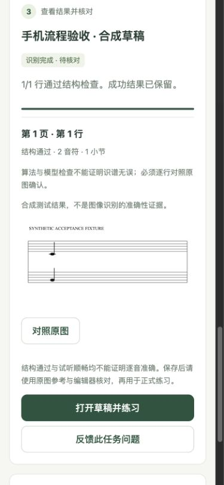
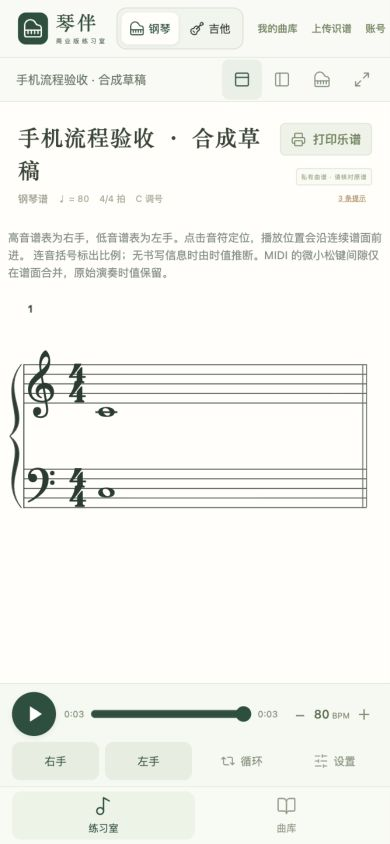
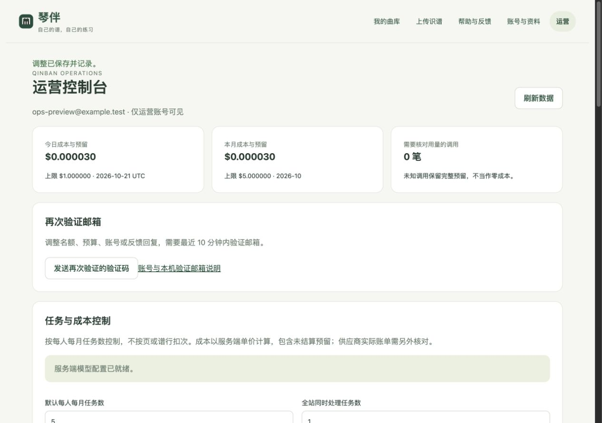

# 独立商业版本机验收记录

日期：2026-10-21。范围：开发者/商业版隔离、托管识谱编排、每人任务数、全站成本控制、手机页面与基本运营。运行环境为本机 Node.js 24.19.0；数据库测试使用临时目录里的 PGlite PostgreSQL，不打开用户默认账号库。

后续更正：用户明确要求保留本机原有识谱。现已恢复 8792 的图片/PDF 导入、识谱任务、模型设置及对应接口，并增加真实前端 DOM 与默认启动参数的回归；下文“禁用本机识谱”的检查仅为当时实现的历史记录，当前边界以 [运行说明](commercial-app-implementation.md) 为准。商业账号版继续独立运行。

## 结果

| 检查 | 结果 |
| --- | --- |
| `npm run check` | 类型检查通过；410 项测试通过，0 失败、0 跳过；60 首曲库校验通过 |
| 最后两项 UI 文案/金额精度调整后的 DOM 回归 | 商业 UI 的 3 项测试全部再次通过 |
| 开发者、Pages、hosted 构建 | `build`、`build:pages`、`build:hosted` 均成功；最后 UI 调整后重新完成 hosted 构建 |
| API 文档基本校验 | 47 个路径、54 个操作、49 个 schema，568 个内部引用均能解析；必填属性存在 |
| 原有数据保全 | 本轮开始前登记的 2,165 个文件 SHA-256 全部一致，未发现缺失或改写 |
| 其他会话脚本 | 登记的 6 个幻听识谱脚本 SHA-256 全部一致，其中 5 个原有未提交改动继续留在工作区 |
| 浏览器流程 | 独立临时账号、原谱上传、选行、提交 1 次、保存草稿、私有曲库打开、播放到末尾、反馈提交、运营回复和任务数调整均已实际操作 |

构建仍有已有大型乐谱/音频依赖的 chunk 体积提示，构建成功不代表首屏体积已经优化。测试与构建日志在忽略目录 `.local/commercial-final-*-20261021.log`，文件保全结果为 `.local/commercial-data-preservation-20261021.json`。

收尾检查发现既有 8792 进程仍占用端口，`/api/status` 返回 404，不能证明它已加载本轮代码。因此没有中断该进程；更新启动器会识别占用并提示在原终端结束任务后重启，不再静默复用其他版本。启动器语法检查通过，实际占用情形提示并以 1 退出，现有监听保留。源码和构建同步不等于已替换该在运行的进程。

## 有意义的新增自动化覆盖

`tests/commercial-recognition.test.mjs`：

- 正常队列、结构检查、tempo 未知回退、私有草稿保存、重复保存同一结果、原谱关联；不把模型结果写成人工确认。
- 排队取消自动退名额；两行部分失败后只重试失败行，成功行不重复调用。
- 不同账号并发请求时串行预留预算；余额不足的任务不发出生成调用，也不占用任务名额。
- 响应不确定时保留全部预留、暂停新任务；普通用户不能核对费用，运营核对和名额补偿均留审计且不重复补偿。
- 返回模型/high 档位缺失或不符时保留预留为未知费用，保存观察值供运营核对，阻止草稿入库。
- 失效租约恢复为中断/未知，不自动再调模型。
- 真正生成的双页 PDF 经服务器预览和裁切，原 PDF 字节保持一致。
- 运营角色、暂停账号与会话撤销、每人上限、跨账号反馈隔离。
- 同键创建不重复占次、达到个人上限拒绝、UTC 跨月和跨年重置时间。
- 定时清理保护任务的原谱和裁图；任务明细过期后，已保存曲谱历史继续保护文件。
- Responses 请求形状、high、60,000 输出上限、usage 计价、reasoning 不重复收费；明确拒绝与 408/409/499/500 等不确定错误分别处理，错误请求均不自动重试。所有 transport 均为合成模拟。

`tests/commercial-http.test.mjs` 覆盖真实隔离 HTTP：游客/普通用户/运营角色，Cookie 与 CSRF、Origin、近期验证，服务未配置时保持关闭，原本机模型/设置接口不暴露，来源页不存在时 404。开发者启动状态不读取模型凭据，并在旧处理器之前拒绝商业与模型调用。

`tests/commercial-ui.test.mjs` 用 JSDOM 运行真实前端模块，检查相机入口、上传失败后保留文件并以同键重试、选行后只提交一个任务、隐藏普通用户运营项、反馈文字转义与失败草稿保留。Service Worker 测试确认 API 不被拦截、不缓存私有响应，离线导航返回无私有内容的重连提示。这些 DOM 测试不是物理手机证据。

## 浏览器与手机宽度验收

使用 IAB 的 Chromium 浏览器，在 390 × 844 和 1280 × 900 视口操作。测试服务仅监听本机 8794，使用新建临时目录和 `example.test` 账号，未使用已有 `.local/accounts-v1/`。真实邮件发送 0 次，真实生成模型调用 0 次。首页与识谱页明确显示“隔离验收 / 合成夹具”公告。

实际流程：

1. 普通受邀测试账号通过本机开发邮箱验证码登录；普通导航不出现运营入口。
2. 从文件选择器上传合成 PNG，查看页序预览，保存原谱。此时显示已用 `0/5`，没有开始识别。
3. 滑块选择全图内测试谱行、确认范围并提交；任务显示结构通过 `1/1`，已用 `1/5`、余 `4`。原图对照能显示保存的裁图。
4. 保存草稿后出现“打开草稿并练习”；打开的是 1 小节、2 音符的合成私有曲谱，带待核对提示。播放进度自然到 4 拍 / 0:03，回到“播放”状态，浏览器错误与警告日志为空。只验证控制与时间线，不声称做了真机听感或识谱准确率验收。
5. 返回商业首页，私有曲库有 1 首曲目、任务状态正确；提交手机体验反馈，页面显示已收到。
6. 退出普通用户后私有内容清空；运营账号登录后其自身曲库为 0 首，独立出现运营导航。
7. 运营看到任务状态、模拟成本与用量，回复反馈为已处理；把测试用户月任务上限从 5 改到 6，回显 `1/6`。金额显示到美元百万分之一，没有把小额费用四舍五入成零。
8. 390px 视口下首页、识谱页和运营页的文档宽度为 375px（可用宽度含滚动条），无整页横向溢出；运营宽表在自身容器内滚动。最后复位临时视口并关闭验收服务。

截图只含临时合成资料，不含用户原谱或真实账户：

| 手机私有曲库 | 手机识谱结果与原图 |
| --- | --- |
|  |  |

## 数据与交付边界

保全登记位于 `.local/commercial-implementation-backup-20261021/manifest.json`。本轮结束比对：`.local/library-v2/` 266/266、`.local/full-score-jobs/` 857/857、`.local/accounts-v1/` 1,042/1,042 个已登记文件内容相同。研究脚本、未跟踪实验输出和历史识谱记录未清理。

本轮没有重跑真实付费照片识别，没有新增准确率数字。24 张真实照片的既有实验与独立参考分母仍见 [原报告](phone-score-accuracy-20261021.md)。本轮合成 provider 仅证明流程、权限、额度与成本状态机。

真实 PostgreSQL 连接与迁移、独立付费模型/单价、SMTP、域名 TLS、多设备与 iPhone/iPad 真机相机、Safari 后台/安装均尚未接入或验收。上线前应以实际供应商确认模型与计数协议，并核对用量账单；应用预算不是供应商结算账单。源码同步和静态 Pages 工作流也不能作为商业服务已部署的证明。支付订阅与教师分享仍未实现。
